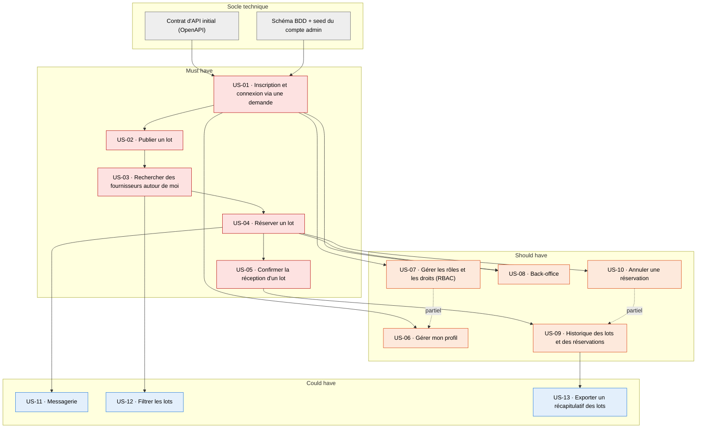

# Gaspirator

Plateforme de mise en relation entre des **fournisseurs** de denrées alimentaires (cantines, hôpitaux, supermarchés…) et des **associations**, pour donner les surplus au lieu de les jeter.

- **Front web** : fournisseurs et back-office admin
- **App mobile** : associations
- **Back** + **base de données**

Liens : [GitHub Project](https://github.com/users/Nathanmar/projects/3) · [Notion](https://app.notion.com/p/Projet-409243b4cee0809bb06ee2814d7a2789)

## Backlog (MoSCoW)

| Issue | User story | Priorité | Client |
|---|---|---|---|
| [#1](https://github.com/Nathanmar/gaspirator/issues/1) | Inscription et connexion via une demande | Must | web, mobile, back-office |
| [#2](https://github.com/Nathanmar/gaspirator/issues/2) | Publier un lot | Must | web |
| [#3](https://github.com/Nathanmar/gaspirator/issues/3) | Rechercher des fournisseurs autour de moi | Must | mobile |
| [#4](https://github.com/Nathanmar/gaspirator/issues/4) | Réserver un lot | Must | mobile |
| [#5](https://github.com/Nathanmar/gaspirator/issues/5) | Confirmer la réception d'un lot | Must | web |
| [#6](https://github.com/Nathanmar/gaspirator/issues/6) | Gérer mon profil | Should | web, mobile |
| [#7](https://github.com/Nathanmar/gaspirator/issues/7) | Gérer les rôles et les droits (RBAC) | Should | web, mobile, back-office |
| [#8](https://github.com/Nathanmar/gaspirator/issues/8) | Gérer les fournisseurs et les associations (back-office) | Should | back-office |
| [#9](https://github.com/Nathanmar/gaspirator/issues/9) | Consulter l'historique des lots et des réservations | Should | web, mobile |
| [#10](https://github.com/Nathanmar/gaspirator/issues/10) | Annuler une réservation | Should | mobile |
| [#11](https://github.com/Nathanmar/gaspirator/issues/11) | Messagerie | Could | web, mobile |
| [#12](https://github.com/Nathanmar/gaspirator/issues/12) | Filtrer les lots | Could | mobile |
| [#13](https://github.com/Nathanmar/gaspirator/issues/13) | Exporter un récapitulatif des lots | Could | web |

## Carte des dépendances

Une flèche **A → B** signifie que **B ne peut pas être terminée avant A**. Une flèche en pointillés indique une dépendance partielle : seule une partie de B attend A.

| Story | Priorité | Dépend de | Pourquoi |
|---|---|---|---|
| US-01 | Must | Socle | Il faut le contrat, le schéma de la base et un premier compte admin pour accepter les demandes |
| US-02 | Must | US-01 | Seul un fournisseur accepté peut publier, et son adresse géocodée situe le lot |
| US-03 | Must | US-02 | Il faut des lots publiés à afficher, et la position de l'association (US-01) |
| US-04 | Must | US-03 | On réserve depuis la fiche d'un lot trouvé par la recherche |
| US-05 | Must | US-04 | Le code de collecte est généré à la réservation |
| US-06 | Should | US-01, US-07 (partiel) | Modifier l'organisation est réservé au responsable, un rôle introduit par US-07 |
| US-07 | Should | US-01 | Étend les rôles de base (fournisseur, association, admin) posés par US-01 |
| US-08 | Should | US-01, US-04 | Reprend la validation des demandes ; suspendre une organisation annule ses réservations |
| US-09 | Should | US-05, US-10 (partiel) | Les statuts « collectée » et « annulée » viennent de ces stories |
| US-10 | Should | US-04 | On annule une réservation existante et la quantité est rendue au lot |
| US-11 | Could | US-04 | Les messages sont rattachés à une réservation |
| US-12 | Could | US-03 | Les filtres s'ajoutent à la recherche |
| US-13 | Could | US-09 | L'export reprend les données et les totaux de l'historique |

### Points d'attention

- **Le MVP est livrable seul** : aucune story Must ne dépend d'une Should ou d'une Could.
- **Le chemin critique est séquentiel** : Socle → US-01 → US-02 → US-03 → US-04 → US-05. Pour travailler en parallèle, on écrit d'abord le contrat de ces cinq stories. Ensuite, le web (US-02, US-05) et le mobile (US-03, US-04) avancent sur des mocks générés depuis le contrat pendant que le back implémente.
- **RBAC** : US-01 doit déjà distinguer fournisseur, association et admin, et le back doit vérifier ces rôles. US-07 ajoute seulement les rôles internes à une organisation (responsable, membre). Si l'équipe ne valide pas ce découpage, RBAC remonte en Must.
- **US-04 est la story la plus risquée côté back** : plusieurs associations peuvent réserver en même temps sur la même quantité restante. Mieux vaut l'attaquer tôt.
