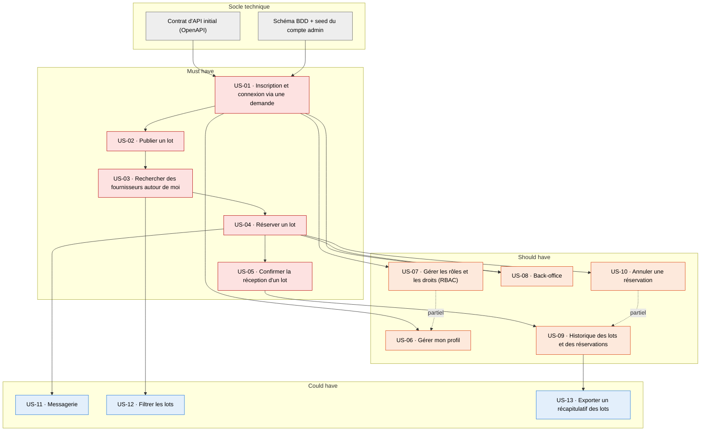

# Gaspirator

Plateforme de mise en relation entre des **fournisseurs** de denrées alimentaires (cantines, hôpitaux, supermarchés…) et des **associations**, pour donner les surplus au lieu de les jeter.

- **Front web** : fournisseurs et back-office admin
- **App mobile** : associations
- **Back** + **base de données**

Liens : [GitHub Project](https://github.com/users/Nathanmar/projects/3) · [Notion](https://app.notion.com/p/Projet-409243b4cee0809bb06ee2814d7a2789)

## Backlog (MoSCoW)

| Issue | User story | Priorité | Client |
|---|---|---|---|
| [#1](https://github.com/Nathanmar/gaspirator/issues/1) | Inscription et connexion via une demande | Must | web, mobile, back-office |
| [#2](https://github.com/Nathanmar/gaspirator/issues/2) | Publier un lot | Must | web |
| [#3](https://github.com/Nathanmar/gaspirator/issues/3) | Rechercher des fournisseurs autour de moi | Must | mobile |
| [#4](https://github.com/Nathanmar/gaspirator/issues/4) | Réserver un lot | Must | mobile |
| [#5](https://github.com/Nathanmar/gaspirator/issues/5) | Confirmer la réception d'un lot | Must | web |
| [#6](https://github.com/Nathanmar/gaspirator/issues/6) | Gérer mon profil | Should | web, mobile |
| [#7](https://github.com/Nathanmar/gaspirator/issues/7) | Gérer les rôles et les droits (RBAC) | Should | web, mobile, back-office |
| [#8](https://github.com/Nathanmar/gaspirator/issues/8) | Gérer les fournisseurs et les associations (back-office) | Should | back-office |
| [#9](https://github.com/Nathanmar/gaspirator/issues/9) | Consulter l'historique des lots et des réservations | Should | web, mobile |
| [#10](https://github.com/Nathanmar/gaspirator/issues/10) | Annuler une réservation | Should | mobile |
| [#11](https://github.com/Nathanmar/gaspirator/issues/11) | Messagerie | Could | web, mobile |
| [#12](https://github.com/Nathanmar/gaspirator/issues/12) | Filtrer les lots | Could | mobile |
| [#13](https://github.com/Nathanmar/gaspirator/issues/13) | Exporter un récapitulatif des lots | Could | web |

## Découpage par couche et endpoints

Chaque story est découpée en une tâche par couche : **Back**, **Web** (y compris le back-office) et **Mobile**. Une story qui touche deux couches a donc deux lignes, trois si elle touche aussi le mobile. Pour le back, la colonne liste les endpoints exposés ; pour le web et le mobile, les endpoints consommés.

Conventions : tous les endpoints sont préfixés par `/api`. `/me/...` désigne les ressources de l'utilisateur connecté et de son organisation. `/admin/...` est réservé aux admins.

| US | Priorité | Couche | À faire | Endpoints |
|---|---|---|---|---|
| US-01 | Must | Back | Demandes d'inscription, validation admin, authentification (token + refresh), rôles de base (fournisseur, association, admin), seed admin, e-mail de décision | `POST /registration-requests` `GET /admin/registration-requests` `POST /admin/registration-requests/{id}/approve` `POST /admin/registration-requests/{id}/reject` `POST /auth/login` `POST /auth/refresh` `POST /auth/logout` `GET /me` |
| US-01 | Must | Web | Formulaire de demande fournisseur, connexion, page admin minimale des demandes | `POST /registration-requests` `POST /auth/login` `POST /auth/refresh` `GET /me` `GET /admin/registration-requests` `POST /admin/registration-requests/{id}/approve` `POST /admin/registration-requests/{id}/reject` |
| US-01 | Must | Mobile | Formulaire de demande association, connexion, session persistante | `POST /registration-requests` `POST /auth/login` `POST /auth/refresh` `GET /me` |
| US-02 | Must | Back | Création d'un lot avec validations (quantité, DLC, créneau, allergènes), lot divisible ou non | `POST /lots` |
| US-02 | Must | Web | Formulaire de publication d'un lot | `POST /lots` |
| US-03 | Must | Back | Recherche géographique des fournisseurs ayant des lots disponibles, fiche fournisseur, détail d'un lot | `GET /suppliers?lat&lng&radius&page` `GET /suppliers/{id}` `GET /suppliers/{id}/lots` `GET /lots/{id}` |
| US-03 | Must | Mobile | Liste des fournisseurs triée par distance, fiche fournisseur, fiche lot | `GET /suppliers` `GET /suppliers/{id}` `GET /suppliers/{id}/lots` `GET /lots/{id}` |
| US-04 | Must | Back | Réservation (quantité, heure de passage) sans surréservation, génération du code de collecte, lots et réservations du fournisseur | `POST /lots/{id}/reservations` `GET /me/reservations` `GET /reservations/{id}` `GET /me/lots` `GET /lots/{id}/reservations` |
| US-04 | Must | Mobile | Bouton « Réserver » (quantité, heure), écran « Mes réservations » avec code, QR code et statut | `POST /lots/{id}/reservations` `GET /me/reservations` `GET /reservations/{id}` |
| US-04 | Must | Web | Liste des lots en cours du fournisseur avec leurs réservations | `GET /me/lots` `GET /lots/{id}` `GET /lots/{id}/reservations` |
| US-05 | Must | Back | Vérification du code, passage en « collectée », limitation des tentatives | `POST /reservations/{id}/confirm` |
| US-05 | Must | Web | Saisie du code de collecte sur une réservation | `POST /reservations/{id}/confirm` |
| US-06 | Should | Back | Modification du compte et de l'organisation, changement de mot de passe, retour en validation si le SIRET ou le RNA change | `PATCH /me` `PUT /me/password` `GET /me/organization` `PATCH /me/organization` |
| US-06 | Should | Web | Page « Profil » du fournisseur | `GET /me` `PATCH /me` `PUT /me/password` `GET /me/organization` `PATCH /me/organization` |
| US-06 | Should | Mobile | Page « Profil » de l'association | `GET /me` `PATCH /me` `PUT /me/password` `GET /me/organization` `PATCH /me/organization` |
| US-07 | Should | Back | Rôles responsable et membre, vérification des droits sur tous les endpoints, invitations | `GET /me/organization/members` `POST /me/organization/invitations` `POST /invitations/{token}/accept` `PATCH /me/organization/members/{userId}` `DELETE /me/organization/members/{userId}` |
| US-07 | Should | Web | Page « Membres », acceptation d'une invitation, actions interdites masquées | `GET /me/organization/members` `POST /me/organization/invitations` `POST /invitations/{token}/accept` `PATCH /me/organization/members/{userId}` `DELETE /me/organization/members/{userId}` |
| US-07 | Should | Mobile | Page « Membres », acceptation d'une invitation, actions interdites masquées | `GET /me/organization/members` `POST /me/organization/invitations` `POST /invitations/{token}/accept` `PATCH /me/organization/members/{userId}` `DELETE /me/organization/members/{userId}` |
| US-08 | Should | Back | Gestion des organisations (liste, fiche, modification, suspension), modération des lots, consultation des réservations | `GET /admin/organizations` `GET /admin/organizations/{id}` `PATCH /admin/organizations/{id}` `POST /admin/organizations/{id}/suspend` `POST /admin/organizations/{id}/reactivate` `GET /admin/lots` `POST /admin/lots/{id}/withdraw` `GET /admin/reservations` |
| US-08 | Should | Web | Écrans du back-office, avec le traitement des demandes d'inscription (US-01) intégré | Tous les endpoints `/admin/...` |
| US-09 | Should | Back | Filtres (statut, période) et pagination sur les lots et les réservations | `GET /me/lots?status&from&to&page` `GET /me/reservations?status&from&to&page` |
| US-09 | Should | Web | Écran « Historique » du fournisseur | `GET /me/lots` `GET /lots/{id}/reservations` |
| US-09 | Should | Mobile | Écran « Historique » de l'association | `GET /me/reservations` |
| US-10 | Should | Back | Annulation, quantité rendue au lot, code invalidé | `POST /reservations/{id}/cancel` |
| US-10 | Should | Mobile | Bouton « Annuler » dans « Mes réservations » | `POST /reservations/{id}/cancel` |
| US-11 | Could | Back | Messages rattachés à une réservation, accès limité aux deux organisations, flux temps réel | `GET /reservations/{id}/messages` `POST /reservations/{id}/messages` `GET /reservations/{id}/messages/stream` (SSE) |
| US-11 | Could | Web | Fil de messages sur une réservation | `GET /reservations/{id}/messages` `POST /reservations/{id}/messages` `GET /reservations/{id}/messages/stream` |
| US-11 | Could | Mobile | Fil de messages sur une réservation | `GET /reservations/{id}/messages` `POST /reservations/{id}/messages` `GET /reservations/{id}/messages/stream` |
| US-12 | Could | Back | Paramètres de filtre sur la recherche | `GET /suppliers?category&excludeAllergens&supplierType&storage&pickupFrom&pickupTo` `GET /suppliers/{id}/lots` (mêmes filtres) |
| US-12 | Could | Mobile | Écran de filtres de la recherche | `GET /suppliers` `GET /suppliers/{id}/lots` |
| US-13 | Could | Back | Génération asynchrone d'un export CSV ou PDF | `POST /me/exports` `GET /me/exports/{id}` `GET /me/exports/{id}/file` |
| US-13 | Could | Web | Bouton d'export, suivi de la génération, téléchargement | `POST /me/exports` `GET /me/exports/{id}` `GET /me/exports/{id}/file` |

## Carte des dépendances

Une flèche **A → B** signifie que **B ne peut pas être terminée avant A**. Une flèche en pointillés indique une dépendance partielle : seule une partie de B attend A.

| Story | Priorité | Dépend de | Pourquoi |
|---|---|---|---|
| US-01 | Must | Socle | Il faut le contrat, le schéma de la base et un premier compte admin pour accepter les demandes |
| US-02 | Must | US-01 | Seul un fournisseur accepté peut publier, et son adresse géocodée situe le lot |
| US-03 | Must | US-02 | Il faut des lots publiés à afficher, et la position de l'association (US-01) |
| US-04 | Must | US-03 | On réserve depuis la fiche d'un lot trouvé par la recherche |
| US-05 | Must | US-04 | Le code de collecte est généré à la réservation |
| US-06 | Should | US-01, US-07 (partiel) | Modifier l'organisation est réservé au responsable, un rôle introduit par US-07 |
| US-07 | Should | US-01 | Étend les rôles de base (fournisseur, association, admin) posés par US-01 |
| US-08 | Should | US-01, US-04 | Reprend la validation des demandes ; suspendre une organisation annule ses réservations |
| US-09 | Should | US-05, US-10 (partiel) | Les statuts « collectée » et « annulée » viennent de ces stories |
| US-10 | Should | US-04 | On annule une réservation existante et la quantité est rendue au lot |
| US-11 | Could | US-04 | Les messages sont rattachés à une réservation |
| US-12 | Could | US-03 | Les filtres s'ajoutent à la recherche |
| US-13 | Could | US-09 | L'export reprend les données et les totaux de l'historique |

### Points d'attention

- **Le MVP est livrable seul** : aucune story Must ne dépend d'une Should ou d'une Could.
- **Le chemin critique est séquentiel** : Socle → US-01 → US-02 → US-03 → US-04 → US-05. Pour travailler en parallèle, on écrit d'abord le contrat de ces cinq stories. Ensuite, le web (US-02, US-05) et le mobile (US-03, US-04) avancent sur des mocks générés depuis le contrat pendant que le back implémente.
- **RBAC** : US-01 doit déjà distinguer fournisseur, association et admin, et le back doit vérifier ces rôles. US-07 ajoute seulement les rôles internes à une organisation (responsable, membre). Si l'équipe ne valide pas ce découpage, RBAC remonte en Must.
- **US-04 est la story la plus risquée côté back** : plusieurs associations peuvent réserver en même temps sur la même quantité restante. Mieux vaut l'attaquer tôt.

### Endpoints et écrans

Chaque endpoint est mis en face des écrans qui l'appellent. Un endpoint peut servir à plusieurs écrans, et un écran peut appeler plusieurs endpoints. Les écrans du back-office (BO) font partie du front web.

| Endpoint | Écrans | US |
|---|---|---|
| `POST /registration-requests` | Web · Demande d'inscription Mobile · Demande d'inscription | US-01 |
| `GET /admin/registration-requests` | BO · Demandes d'inscription | US-01 |
| `POST /admin/registration-requests/{id}/approve` | BO · Demandes d'inscription | US-01 |
| `POST /admin/registration-requests/{id}/reject` | BO · Demandes d'inscription | US-01 |
| `POST /auth/login` | Web · Connexion Mobile · Connexion | US-01 |
| `POST /auth/refresh` | *Aucun écran* (voir plus bas) | US-01 |
| `POST /auth/logout` | Web · Profil Mobile · Profil | US-01 |
| `GET /me` | Web · Connexion Web · Profil Mobile · Démarrage Mobile · Connexion Mobile · Profil | US-01, US-06 |
| `POST /lots` | Web · Publier un lot | US-02 |
| `GET /suppliers` | Mobile · Recherche de fournisseurs | US-03, US-12 |
| `GET /suppliers/{id}` | Mobile · Fiche fournisseur | US-03 |
| `GET /suppliers/{id}/lots` | Mobile · Fiche fournisseur | US-03, US-12 |
| `GET /lots/{id}` | Mobile · Fiche lot Web · Détail d'un lot | US-03, US-04 |
| `POST /lots/{id}/reservations` | Mobile · Réserver un lot | US-04 |
| `GET /me/reservations` | Mobile · Mes réservations Mobile · Historique | US-04, US-09 |
| `GET /reservations/{id}` | Mobile · Code de collecte | US-04 |
| `GET /me/lots` | Web · Mes lots Web · Historique | US-04, US-09 |
| `GET /lots/{id}/reservations` | Web · Détail d'un lot Web · Historique | US-04, US-09 |
| `POST /reservations/{id}/confirm` | Web · Saisie du code de collecte | US-05 |
| `PATCH /me` | Web · Profil Mobile · Profil | US-06 |
| `PUT /me/password` | Web · Profil Mobile · Profil | US-06 |
| `GET /me/organization` | Web · Profil Mobile · Profil | US-06 |
| `PATCH /me/organization` | Web · Profil Mobile · Profil | US-06 |
| `GET /me/organization/members` | Web · Membres Mobile · Membres | US-07 |
| `POST /me/organization/invitations` | Web · Membres Mobile · Membres | US-07 |
| `POST /invitations/{token}/accept` | Web · Acceptation d'une invitation Mobile · Acceptation d'une invitation | US-07 |
| `PATCH /me/organization/members/{userId}` | Web · Membres Mobile · Membres | US-07 |
| `DELETE /me/organization/members/{userId}` | Web · Membres Mobile · Membres | US-07 |
| `GET /admin/organizations` | BO · Organisations | US-08 |
| `GET /admin/organizations/{id}` | BO · Fiche organisation | US-08 |
| `PATCH /admin/organizations/{id}` | BO · Fiche organisation | US-08 |
| `POST /admin/organizations/{id}/suspend` | BO · Fiche organisation | US-08 |
| `POST /admin/organizations/{id}/reactivate` | BO · Fiche organisation | US-08 |
| `GET /admin/lots` | BO · Lots | US-08 |
| `POST /admin/lots/{id}/withdraw` | BO · Lots | US-08 |
| `GET /admin/reservations` | BO · Réservations | US-08 |
| `POST /reservations/{id}/cancel` | Mobile · Mes réservations | US-10 |
| `GET /reservations/{id}/messages` | Web · Messagerie Mobile · Messagerie | US-11 |
| `POST /reservations/{id}/messages` | Web · Messagerie Mobile · Messagerie | US-11 |
| `GET /reservations/{id}/messages/stream` | Web · Messagerie Mobile · Messagerie | US-11 |
| `POST /me/exports` | Web · Export | US-13 |
| `GET /me/exports/{id}` | Web · Export | US-13 |
| `GET /me/exports/{id}/file` | Web · Export | US-13 |

#### Endpoint sans écran

- **`POST /auth/refresh`** : aucun écran ne l'appelle directement. Quand le token d'accès expire, le client HTTP du web et du mobile appelle cet endpoint automatiquement, puis rejoue la requête qui a échoué. L'utilisateur ne voit rien.

#### Écrans sans endpoint

- **Web · Demande envoyée** et **Mobile · Demande envoyée** : page de confirmation affichée après l'envoi de la demande d'inscription. Elle réutilise la réponse de `POST /registration-requests`. L'organisation n'a pas encore de compte, il n'y a donc rien d'autre à charger.
- **Mobile · Filtres** (US-12) : l'écran construit seulement les paramètres de recherche, puis l'écran « Recherche de fournisseurs » rappelle `GET /suppliers` avec ces paramètres. Les choix proposés (catégories, allergènes, types de fournisseur) sont des listes fixées dans le contrat, pas des données à charger.
